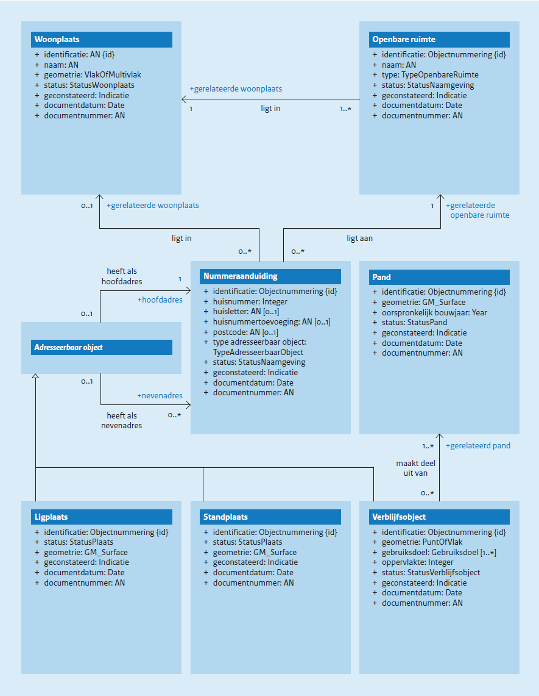

# Conceptueel model {#2C956665}

<a href='#'>Figuur 3</a> geeft een vereenvoudigde weergave van de conceptuele modellering van de BAG-objecttypen. De beschrijving van deze objecttypen staat in hoofdstuk 6 en die van hun eigenschappen in hoofdstuk 7 en hoofdstuk 8. De eigenschappen worden door alle BAG-objecttypen overerfd.

 
 

Objecttypen met een schuingedrukte naam zijn abstracte objecttypen. Deze komen niet als concreet object voor in een BAG-product.

</img>
 
 
<ol><li>Conceptueel gegevensmodel met objecttypen, attributen en onderlinge relaties</li>
</ol>
