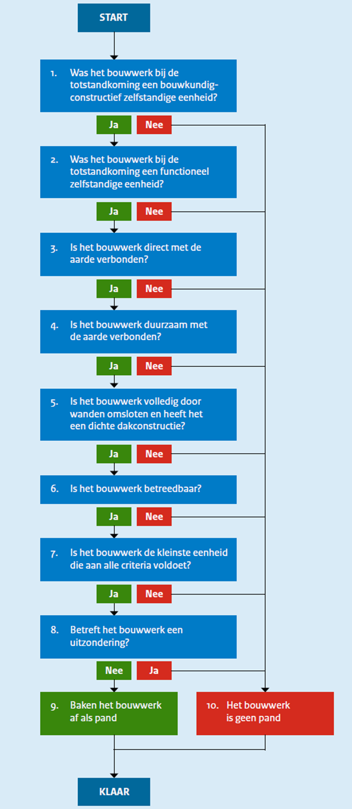
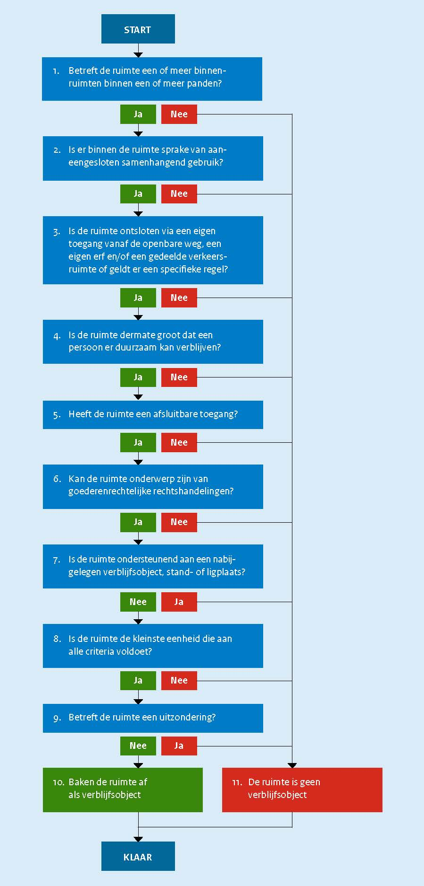

# Objectafbakening {#5FDDB297}

## Inleiding {#1BF1416C}

Om de Basisregistratie Adressen en Gebouwen te kunnen laten functioneren is het noodzakelijk om de landelijke uniformiteit van de inhoud van de basisregistratie te waarborgen. Hiervoor is het noodzakelijk om regels te geven voor het herkennen van objecten. Dit hoofdstuk van de catalogus geeft deze regels en gaat over het kijken naar de werkelijkheid door de bril van de BAG, met de bedoeling om de objecten te herkennen waarover de BAG gegevens bijhoudt. Terwijl dit hoofdstuk dus beschrijft over welke dingen uit de werkelijkheid de BAG gegevens bijhoudt, gaan de andere hoofdstukken vooral over welke gegevens dat zijn en hoe het bijhouden gebeurt.

## Toekenning van nummeraanduidingen {#66034D93}

Een verblijfsobject, standplaats of ligplaats heeft een nummeraanduiding voor het hoofdadres en kan een of meer nummeraanduidingen voor nevenadressen hebben. Een nevenadres mag alleen worden toegekend wanneer er meerdere relevante toegangen zijn en een toegang een wezenlijke betekenis heeft bij het aanduiden van het object, zoals een leveranciersingang.

Een nevenadres is een eigenschap van het geheel van hetzelfde verblijfsobject of dezelfde standplaats of ligplaats als het hoofdadres en niet van slechts een gedeelte ervan.

## Vaststelling van openbare ruimten {#567FE306}

De vaststelling van een openbare ruimte volgt uit de formele aanwijzing van de openbare ruimte door het bevoegde gemeentelijke orgaan.

Als een nummeraanduiding is gelegen aan een openbare ruimte in het buitenland, registreert de gemeente de buitenlandse openbare ruimte alsof deze in de woonplaats van de nummeraanduiding is gelegen.

## Indeling in woonplaatsen {#1E535F0C}

De indeling in woonplaatsen volgt uit de formele aanwijzing van woonplaatsen door het bevoegde gemeentelijke orgaan.

## Afbakening van ligplaatsen {#66D40A92}

De afbakening van een ligplaats volgt uit de formele aanwijzing van de ligplaats door het bevoegde gemeentelijke orgaan. Voor de afbakening van een ligplaats is het niet relevant of de plaats in het water als zodanig in gebruik is.

## Afbakening van panden {#7AB68C04}
<figure id='d6aJgBaBb'></img>
<figcaption>Beslisboom voor de afbakening van panden</figcaption></figure>

<b>START</b>

Voor deze beslisboom (zie <a href='#d6aJgBaBb'>Figuur 4</a>) deelt de bronhouder een bouwkundige constructie op in een of meer bouwwerken en toetst deze elk afzonderlijk aan de definitie van een pand.

 
 

<b>1. Was het bouwwerk bij de totstandkoming een bouwkundig-constructief zelfstandige eenheid?</b>

 
 

Een bouwwerk is een bouwkundig-constructief zelfstandige eenheid als het slopen ervan redelijkerwijs geen aangrenzende bouwkundige constructies zal doen instorten. Elk bouwwerk dat onderdeel uitmaakt van een serie van naast elkaar gebouwde en overwegend gelijkvormige bouwwerken, wordt geacht een bouwkundig-constructief zelfstandige eenheid te zijn.

 
 

Een bouwkundig-constructief onzelfstandige verbinding tussen bouwkundig-constructief zelfstandige bouwwerken, zoals een loopbrug of een ondergrondse doorgang, wordt afgebakend als een deel van één van de verbonden bouwwerken.

 
 

Bouwwerken die deels over elkaar zijn gebouwd, maar wel onafhankelijk van elkaar bouwkundig-constructief zelfstandig zijn, worden onafhankelijk van elkaar afgebakend.

 
 

<b>2. Was het bouwwerk bij de totstandkoming een functioneel zelfstandige eenheid?</b>

 
 

Een pand huisvest bij de totstandkoming nul, een of meer gehele verblijfsobjecten. Daarna mag een verblijfsobject wel in meerdere panden liggen, omdat de afbakening van bestaande panden niet wordt aangepast bij het samenvoegen van verblijfsobjecten.

 
 

Een bouwwerk is geen afzonderlijk pand als dit bouwwerk bij de totstandkoming exclusief ondersteunend is aan het bouwwerk waartegen het rechtstreeks is aangebouwd. Het maakt hierbij niet uit of:

<ul><li>het ondersteunende bouwwerk bouwkundig-constructief zelfstandig is;</li>
<li>het ondersteunende bouwwerk later werd gebouwd dan het bouwwerk waaraan het ondersteunend is;</li>
<li>het ondersteunende bouwwerk alleen buitenom kan worden bereikt door in de openlucht te komen (al dan niet onder een overkapping);</li>
<li>het ondersteunende bouwwerk exclusief ondersteunend is aan slechts een gedeelte van het bouwwerk waartegen het rechtstreeks is aangebouwd;</li>
<li>de bouwwerken deels ook tegen andere bouwwerken zijn aangebouwd;</li>
<li>er ook andere ondersteunende bouwwerken ondersteunend zijn aan hetzelfde bouwwerk.</li>
</ul>
 
 

Dergelijke aangebouwde bouwwerken die exclusief ondersteunend zijn aan hetzelfde bouwwerk, vormen voor de afbakening van panden een ondeelbare eenheid met het bouwwerk waaraan ze ondersteunend zijn.

 
 

<b>3. Is het bouwwerk direct met de aarde verbonden?</b>

 
 

Een pand moet een directe constructieve verbinding met de aarde hebben. Het geheel of gedeeltelijk stapelen van panden kan uitsluitend als al deze panden onafhankelijk van elkaar bouwkundig-constructief zelfstandig zijn.

 
 

<b>4. Is het bouwwerk duurzaam met de aarde verbonden?</b>

 
 

Een bouwwerk kan geen pand zijn als het naar aard en constructie als geheel verplaatsbaar is. Het is verplaatsbaar als het zonder scheiding van integrerende onderdelen die tezamen het bouwwerk vormen, kan worden aangevoerd, verplaatst of afgevoerd. Een subjectieve intentie tot duurzame aanwezigheid is niet doorslaggevend. Elementen die zijn toegevoegd aan een bouwwerk dat op zichzelf verplaatsbaar is (zoals een tochtportaal voor de ingang van een stacaravan) zijn geen integrerende onderdelen.

Dergelijke toevoegingen zijn niet verweven met het geheel, omdat na het verwijderen ervan nog steeds een geheel overblijft dat op zichzelf kan functioneren.

 
 

Als duidelijk is dat een bouwwerk dat aan de definitie van een pand kan voldoen, slechts gedurende beperkte tijd zal bestaan, ligt opname in de registratie niet zonder meer in de rede.

 
 

<b>5. Is het bouwwerk volledig door wanden omsloten en heeft het een dichte dakconstructie?</b>

 
 

Een pand moet bij de totstandkoming over de volledige hoogte zijn omsloten door wanden en een dichte dakconstructie hebben. Beweegbare delen in de gevel, het dak of de laagstgelegen vloer, zoals deuren en ramen, te openen lichtkappen en kruipluiken worden op grond van NEN 2580:2007 niet als permanente openingen beschouwd. Hetzelfde geldt voor ventilatieopeningen en -kanalen in de gevel, in het dak of in de vloer, zelfs als deze niet afsluitbaar zijn. Hekken, roosterwerken en gaasafzettingen zijn op grond van NEN 2580:2007 wel permanente openingen. Beweegbare delen hoeven niet aanwezig zijn, mits ze wel eenvoudig kunnen worden geplaatst.

 
 

Een pand heeft geen andere beweegbare delen dan die voor het openen en sluiten van openingen in de gevel, het dak of de laagstgelegen vloer. Eventuele andere beweegbare delen aan het pand worden niet als permanente openingen beschouwd, mits het bouwwerk tezamen met deze beweegbare delen volledig door wanden is omsloten en een dichte dakconstructie heeft. Beweegbare delen die volledig zijn omsloten door niet-beweegbare, blijven buiten beschouwing.

 
 

Een schuur of stal met openingen in de gevel op circa een meter hoogte wordt als volledig door wanden omsloten beschouwd.

 
 

Een pand hoeft geen dichte vloerconstructie te hebben op het grensvlak met de bodem.

 
 

Niet-afsluitbare openingen die permanent via de vloer in verbinding staan met buiten, zijn daarom toegestaan, bijvoorbeeld voor een trap of een andere voorziening voor verticaal verkeer of voor het open water in een botenhuis.

 
 

Definities uit NEN 2580:2007 zijn overgenomen met toestemming van NEN te Delft, www.nen.nl.

 
 

BRONNEN [26]NEN 2580:2007, artikel 2.1.2: Een binnenruimte is een "ruimte die aan alle zijden volledig wordt begrensd door bouwkundige scheidingsconstructies." Definitie overgenomen met toestemming van NEN te Delft.  https://www.nen.nl/NEN-Shop/Norm/NEN-25802007-nl.htm 
 [27]NEN 2580:2007, toelichting bij artikel 2.1.2: "Een binnenruimte is in beginsel aan alle kanten omsloten door wanden over de volledige hoogte en voorzien van een dichte vloerconstructie aan zowel de onder-als bovenzijde." [...] "Beweegbare delen in de gevel, het dak of de laagstgelegen vloer, zoals deuren en ramen, te openen lichtkappen en kruipluiken worden niet als permanente openingen beschouwd. Hetzelfde geldt voor ventilatieopeningen en -kanalen in de gevel, in het dak of in de vloer, zelfs als deze niet afsluitbaar zijn." Definitie overgenomen met toestemming van NEN te Delft. https://www.nen.nl/NEN -Shop/Norm/NEN-25802007-nl.htm 
 [28]NEN 2580:2007, artikel 2.1.3: Een gebouwgebonden buitenruimte is een "ruimte die door het deels ontbreken van uitwendige bouwkundige scheidingsconstructies permanent in open verbinding staat met de bodem en/of de buitenlucht. OPMERKING: Gebouwgebonden buitenruimten worden onderscheiden in: overdekte gebouwgebonden buitenruimten en niet-overdekte gebouwgebonden buitenruimten." Definitie overgenomen met toestemming van NEN te Delft. https://www.nen.nl/NEN-Shop/Norm/NEN-2 5802007-nl.htm 
 [29]NEN 2580:2007, toelichting bij artikel 2.1.3: "Ruimten, die plaatselijk van de buitenlucht zijn gescheiden door een hek, roosterwerk of gaasafzetting, zoals half verdiepte parkeergarages en opslagruimten voor gasflessen, worden daarentegen (zie 2.1.2) wel als gebouwgebonden buitenruimten opgevat. Een toegankelijke kruipruimte met een hoogte van 1,5 m of meer en zonder verharde vloer (bijvoorbeeld zandgrond) kan niet als binnenruimte worden aangemerkt, omdat een bouwkundige scheidingsconstructie op het grensvlak met de bodem ontbreekt. Een dergelijke kruipruimte wordt als gebouwgebonden buitenruimte beschouwd. Onder de term 'bodem' wordt ook open water verstaan. Een botenhuis moet om die reden eveneens als gebouwgebonden buitenruimte worden gekwalificeerd.” Definitie overgenomen met toestemming van NEN te Delft. https://www.nen.nl/NEN-Shop/Norm/NEN-2 5802007-nl.htm 
 [30]NEN 2580:2007, artikel 2.2.9: "ruimte of voorziening voor verticaal verkeer: ruimte of voorziening voor de verkeersafwikkeling tussen de bouwlagen van een gebouw". Definitie overgenomen met toestemming van NEN te Delft. https://www.nen.nl/NEN-Shop/Norm/NEN-25802007-nl.htm 
 [31]NEN 2580:2007, toelichting bij artikel 2.2.9: "Voorbeelden van ruimten voor verticaal verkeer zijn trappenhuizen inclusief rooksluizen en liftschachten. Voorbeelden van voorzieningen voor verticaal verkeer zijn (rol)trappen, hefplateaus en hellingbanen, die deel uitmaken van ruimten met andere functies. Als voorwaarde voor verticaal verkeer geldt dat er sprake moet zijn van circulatie tussen de onderscheiden bouwlagen van een gebouw. Buiten beschouwing blijven de voorzieningen, zoals (rol)trappen, hefplateaus en hellingbanen, die een niveauverschil van minder dan 1,5 m overbruggen. Dergelijke hoogteverschillen blijven immers binnen één bouwlaag." Definitie overgenomen met toestemming van NEN te Delft. https://www.nen.nl/NEN-Shop/Norm/NEN-25802007-nl.htm 

 
 

<b>6. Is het bouwwerk betreedbaar?</b>

 
 

Een pand moet bij de totstandkoming voor mensen toegankelijk zijn en voldoende stahoogte bieden aan een volwassen persoon.

 
 

Een pand dient bij de totstandkoming te beschikken over een of meer verticale toegangsdeuren waardoor mensen naar binnen kunnen. Een bouwwerk dat uitsluitend beschikt over andersoortige toegangen, zoals een horizontaal toegangsluik, wordt niet als pand afgebakend.

 
 

Een pand dat na een verbouwing geen eigen toegang meer heeft, blijft een apart pand.

 
 

<b>7. Is het bouwwerk de kleinste eenheid die aan alle criteria voldoet?</b>

 
 

Een pand moet ondeelbaar zijn en mag bij de totstandkoming niet kunnen worden opgedeeld in kleinere eenheden die elk afzonderlijk aan de definitie van een pand voldoen.

 
 

<b>8. Betreft het bouwwerk een uitzondering?</b>

 
 

Voor de afbakening van panden gelden drie uitzonderingen:

<ul><li>Bunkers: Een historische bunker wordt pas afgebakend wanneer deze in gebruik wordt genomen.</li>
<li>Hobbykassen: Een hobbykas (meestal voor privégebruik in tuinen van particulieren) wordt niet als pand afgebakend.</li>
<li>Militaire objecten: Een militair object wordt niet afgebakend wanneer de Minister van Defensie aangeeft dat registratie niet wenselijk is. Normale kantoorruimten en (delen van) kazernes die aan de openbare weg liggen, worden in beginsel wel afgebakend.</li>
</ul>
 
 

<b>9. Baken het bouwwerk af als pand</b>

 
 

Dit bouwwerk voldoet aan de BAG-definitie van een pand.

 
 

<b>10. Het bouwwerk is geen pand</b>

 
 

Hoewel dit bouwwerk op zichzelf geen pand is, kan het wel geheel of gedeeltelijk onderdeel zijn van een pand of, opgeknipt in delen, onderdeel zijn van meerdere panden.

 
 

<b>KLAAR</b>

## Afbakening van standplaatsen {#7F6F1322}

De afbakening van een standplaats volgt uit de formele aanwijzing van de standplaats door het bevoegde gemeentelijke orgaan.

 
 

Voor de afbakening van een standplaats is het niet relevant of het terrein als zodanig in gebruik is.

## Afbakening van verblijfsobjecten {#129B35EA}
<figure id='d6aJiBaBa'></img>
<figcaption>Beslisboom voor de afbakening van verblijfsobjecten</figcaption></figure>

<b>START</b>

Voor deze beslisboom (zie <a href='#d6aJiBaBa'>Figuur 5</a>) deelt de bronhouder een pand of een reeks van panden op in ruimten (niet te verwarren met bijvoorbeeld binnenruimten in de zin van NEN 2580:2007 of verblijfsruimten in de zin van het Bouwbesluit 2012) en toetst elk van deze ruimten afzonderlijk aan de definitie van een verblijfsobject.

 
 

Bij het opdelen van panden in ruimten zoekt de bronhouder naar de kleinste eenheid van gebruik. Hierbij redeneert de bronhouder van binnen naar buiten. De binnenste eigen toegang bepaalt waar een verblijfsobject begint, mits de ruimte achter deze toegang voldoet aan de definitie van een verblijfsobject.

 
 

Vanuit informatiekundig oogpunt zou het afbakenen van verblijfs-en andere objecten moeten plaatsvinden zonder eerst naar het gebruiksdoel of andere attribuutwaarden te kijken. Voor de praktijk van de BAG is het echter nodig dat bijvoorbeeld een garage bij een woning geen verblijfsobject wordt als er een bed in wordt gezet, terwijl wel een verblijfsobject kan ontstaan indien er een bureau in wordt geplaatst voor de uitoefening van een beroep of bedrijf (mits de garage in beide situaties in alle andere opzichten zelfstandig kan voldoen aan de definitie van een verblijfsobject).

 
 

BRONNEN [32]NEN 2580:2007, artikel 2.1.2: Een binnenruimte is een "ruimte die aan alle zijden volledig wordt begrensd door bouwkundige scheidingsconstructies." Definitie overgenomen met toestemming van NEN te Delft.  https://www.nen.nl/NEN-Shop/Norm/NEN-25802007-nl.htm 

 
 

<b>1. Betreft de ruimte een of meer binnenruimten binnen een of meer panden?</b>

 
 

Een verblijfsobject is een eenheid van gebruik die bestaat uit een of meer binnenruimten binnen een of meer panden. Deze binnenruimten moeten voldoen aan de definitie van een binnenruimte volgens NEN 2580:2007.

 
 

Een verblijfsobject moet over de volledige hoogte zijn omsloten door wanden en een dichte plafond-of dakconstructie en een dichte vloerconstructie hebben. Beweegbare delen in de gevel, het dak of de laagstgelegen vloer, zoals deuren en ramen, te openen lichtkappen en kruipluiken worden op grond van NEN 2580:2007 niet als permanente openingen beschouwd. Hetzelfde geldt voor ventilatieopeningen en -kanalen in de gevel, in het dak of in de vloer, zelfs als deze niet afsluitbaar zijn. Hekken, roosterwerken en gaasafzettingen zijn op grond van NEN 2580:2007 wel permanente openingen.

 
 

Verblijfsobjecten zijn bij de totstandkoming van een pand volledig gelegen binnen dat pand. Na een verbouwing kan een verblijfsobject zich uitstrekken over meerdere aaneengesloten panden.

 
 

Definities uit NEN 2580:2007 zijn overgenomen met toestemming van NEN te Delft, www.nen.nl.

 
 

BRONNEN [33]NEN 2580:2007, artikel 2.1.2: Een binnenruimte is een "ruimte die aan alle zijden volledig wordt begrensd door bouwkundige scheidingsconstructies." Definitie overgenomen met toestemming van NEN te Delft.  https://www.nen.nl/NEN-Shop/Norm/NEN-25802007-nl.htm 
 [34]NEN 2580:2007, toelichting bij artikel 2.1.2: "Een binnenruimte is in beginsel aan alle kanten omsloten door wanden over de volledige hoogte en voorzien van een dichte vloerconstructie aan zowel de onder-als bovenzijde. Hierop zijn uitzonderingen mogelijk bijvoorbeeld bij een vide. De aard van de vloeropening en de grootte in relatie tot de totale vloeroppervlakte zullen dan moeten uitwijzen of er sprake is van één binnenruimte of twee of meer binnenruimten, die niet volledig van elkaar zijn gescheiden. Dit onderscheid kan van belang zijn voor het vaststellen van de inhoud van afzonderlijke ruimten. Beweegbare delen in de gevel, het dak of de laagstgelegen vloer, zoals deuren en ramen, te openen lichtkappen en kruipluiken worden niet als permanente openingen beschouwd. Hetzelfde geldt voor ventilatieopeningen en -kanalen in de gevel, in het dak of in de vloer, zelfs als deze niet afsluitbaar zijn. Installatieruimten zoals bedoeld voor het stoken van aardgasapparatuur, containerruimten voor vuilnis of fietsenstallingen die volledig zijn omsloten maar wel continu door een ventilatierooster met buitenlucht worden geventileerd, moeten daarom als binnenruimten worden beschouwd." Definitie overgenomen met toestemming van NEN te Delft. https://www.nen.nl/NEN-Shop/Norm/NEN-25802007nl.htm 
 [35]NEN 2580:2007, artikel 2.1.3: Een gebouwgebonden buitenruimte is een "ruimte die door het deels ontbreken van uitwendige bouwkundige scheidingsconstructies permanent in open verbinding staat met de bodem en/of de buitenlucht. OPMERKING: Gebouwgebonden buitenruimten worden onderscheiden in: overdekte gebouwgebonden buitenruimten en niet-overdekte gebouwgebonden buitenruimten." Definitie overgenomen met toestemming van NEN te Delft. https://www.nen.nl/NEN-Shop/Norm/NEN-2 5802007-nl.htm 
 [36]NEN 2580:2007, toelichting bij artikel 2.1.3: "Ruimten, die plaatselijk van de buitenlucht zijn gescheiden door een hek, roosterwerk of glasafzetting, zoals half verdiepte parkeergarages en opslagruimten voor gasflessen, worden daarentegen (zie 2.1.2) wel als gebouwgebonden buitenruimten opgevat. Een toegankelijke kruipruimte met een hoogte van 1,5 m of meer en zonder verharde vloer (bijvoorbeeld zandgrond) kan niet als binnenruimte worden aangemerkt, omdat een bouwkundige scheidingsconstructie op het grensvlak met de bodem ontbreekt. Een dergelijke kruipruimte wordt als gebouwgebonden buitenruimte beschouwd. Onder de term 'bodem' wordt ook open water verstaan. Een botenhuis moet om die reden eveneens als gebouwgebonden buitenruimte worden gekwalificeerd." Definitie overgenomen met toestemming van NEN te Delft. https://www.nen.nl/NEN-Shop/Norm/NEN-2 5802007-nl.htm 

 
 

<b>2. Is er binnen de ruimte sprake van aaneengesloten samenhangend gebruik?</b>

 
 

Bij een verblijfsobject staat het samenhangende gebruik van een ruimte centraal. Er dient in ruimtelijke zin sprake te zijn van een eenheid van gebruik.

 
 

Er kan alleen sprake zijn van een eenheid van gebruik als die eenheid exclusief beschikt over alle basisvoorzieningen die zijn vereist voor alle gebruiksdoelen van het verblijfsobject.

 
 

Per gebruiksdoel zijn de minimaal vereiste basisvoorzieningen:

<ul><li>bijeenkomstfunctie: water, toilet;</li>
<li>celfunctie: water, toilet;</li>
<li>gezondheidszorgfunctie: water, toilet;</li>
<li>industriefunctie: geen basisvoorzieningen vereist;</li>
<li>kantoorfunctie: water, toilet;</li>
<li>logiesfunctie: keuken, douche, toilet;</li>
<li>onderwijsfunctie: water, toilet;</li>
<li>overige gebruiksfunctie: geen basisvoorzieningen vereist;</li>
<li>sportfunctie: water, toilet;</li>
<li>winkelfunctie: water, toilet;</li>
<li>woonfunctie: keuken, douche, toilet.</li>
</ul>
 
 

De basisvoorzieningen houden in dat een verblijfsobject tezamen met zowel alle nabijgelegen ondersteunende ruimten die exclusief ondersteunend zijn aan het verblijfsobject als met alle nabijgelegen openbaar toegankelijke binnenruimten, minimaal moet beschikken over:

 
 
<ul><li>water: een aansluiting voor drinkwater en een afvoer voor huishoudelijk afvalwater; </li>
<li>keuken: de basisvoorziening water en een aansluiting voor energie en een opstelplaats voor een aanrecht en een opstelplaats voor een kooktoestel; </li>
<li>douche: de basisvoorziening water en een aansluiting voor energie en een opstelplaats voor een douche of een bad; </li>
<li>toilet: de basisvoorziening water en een opstelplaats voor een toilet.</li>
</ul>
 
 

De binnenruimten van een verblijfsobject moeten onderling binnendoor bereikbaar zijn zonder het verblijfsobject te verlaten. Binnenruimten aan weerszijden van bouwkundige scheidingsconstructies tussen bouwwerken die tezamen een ondeelbare eenheid vormen in de afbakening van panden (zie stap 2 van § <a href='#7AB68C04'>10.6</a>) en die elk alleen daarom niet zelfstandig voldoen aan de definitie van een pand, worden hierbij geacht onderling binnendoor bereikbaar te zijn als het ontbreken van openingen in dergelijke scheidingsconstructies de enige belemmering vormt om een groter verblijfsobject af te bakenen. Zo maakt een garagebox die rechtstreeks tegen een woning is aangebouwd en exclusief ondersteunend is aan de woning, samen met de woning deel uit van hetzelfde verblijfsobject, ongeacht of de garagebox vanuit de woning alleen te bereiken is door in de openlucht te komen.

 
 

<b>3. Is de ruimte ontsloten via een eigen toegang vanaf de openbare weg, een erf en/of een gedeelde verkeersruimte of geldt er een specifieke regel?</b>

 
 

Een verblijfsobject moet beschikken over een of meer eigen afsluitbare toegangen vanaf de openbare weg, een erf en/of een gedeelde verkeersruimte, tenzij een specifieke regel in deze catalogus toestaat dat een verblijfsobject is ontsloten via een ander verblijfsobject. Ongeacht hoe de ruimte is ontsloten, maken gedeelde verkeersruimten nooit deel uit van het verblijfsobject.

 
 

Specifieke regel voor ziekenhuizen

Een ziekenhuis als geheel zal in het algemeen worden aangemerkt als één verblijfsobject. De gebruikelijke situatie zal zijn dat een groot ziekenhuis wordt beschouwd als één pand met één verblijfsobject. Eventuele inpandige zelfstandige ruimten (zoals bijvoorbeeld een zelfstandig afsluitbaar restaurant of een zelfstandig functionerende en afsluitbare praktijk voor fysiotherapie) worden als verblijfsobject onderscheiden mits ze beschikken over een eigen toegang (vanaf de openbare weg, een erf of een gedeelde verkeersruimte). Dat geldt ook als de toegang tot deze ruimte loopt via een hal of gang van het ziekenhuis. Bekeken vanuit de zelfstandige praktijkruimte of het restaurant in het ziekenhuis functioneren de hal en de gangen van het ziekenhuis als ontsluiting. Ruimtes voor specialistische artsen en poliklinieken worden beschouwd als integraal onderdeel van het ziekenhuis en worden niet als verblijfsobject afgebakend.

 
 

Specifieke regel voor zorgcomplexen

Het kan zijn dat een gedeelte van het complex per kamer zal worden afgebakend, terwijl een ander deel één verblijfsobject vormt, dat dan bestaat uit bijvoorbeeld een bijeenkomstruimte, verpleegkamers, keuken en dergelijke. Daarbij kan zich de situatie voordoen dat de hal en gang van het grote verblijfsobject ook dienen ter ontsluiting van de los afgebakende kamers.

 
 

Specifieke regel voor studentencomplexen

Een deel van een verblijfsobject kan tegelijkertijd dienen als ontsluiting voor andere verblijfsobjecten.

 
 

Specifieke regel voor recepties bij de toegang van een gebouw

Als een ruimte met een receptie voldoet aan de definitie van een verblijfsobject, dan wordt deze ruimte afgebakend als verblijfsobject. Als het afbakenen van de ruimte met de receptie tot gevolg zou hebben dat andere ruimten hun eigen toegang tot de openbare weg, een erf en/of een gedeelde verkeersruimte kwijtraken en alleen daardoor niet meer zelfstandig aan de definitie van een verblijfsobject voldoen, dan dient het verblijfsobject met de receptie als ontsluiting voor de daarachter gelegen verblijfsobjecten.

 
 

<b>4. Is de ruimte dermate groot dat een persoon er duurzaam kan verblijven?</b>

 
 

Een verblijfsobject is voor mensen toegankelijk en heeft voldoende stahoogte voor een volwassen persoon.

Een verblijfsobject moet beschikken over een of meer verticale toegangsdeuren. Een ruimte die uitsluitend beschikt over andersoortige toegangen, zoals een horizontaal toegangsluik, wordt niet als verblijfsobject afgebakend.

 
 

<b>5. Heeft de ruimte een afsluitbare toegang?</b>

 
 

Een verblijfsobject moet exclusief te gebruiken zijn. Alle toegangen van een verblijfsobject moeten daarom afsluitbaar zijn. Sloten en beweegbare delen in de gevel, het dak of de laagstgelegen vloer, zoals deuren en ramen, te openen lichtkappen en kruipluiken hoeven niet aanwezig zijn, mits deze wel eenvoudig kunnen worden geplaatst.

 
 

<b>6. Kan de ruimte onderwerp zijn van goederenrechtelijke rechtshandelingen?</b>

 
 

Een ruimte die niet onderwerp kan zijn van goederenrechtelijke rechtshandelingen, zoals koop en verkoop, bijvoorbeeld een hotelkamer, een slaapruimte in een verzorgingshuis of een cel in een gevangenis, kan geen verblijfsobject zijn.

 
 

<b>7. Is de ruimte ondersteunend aan een nabijgelegen verblijfsobject, standplaats of ligplaats?</b>

 
 

Een ondersteunende ruimte die exclusief ondersteunend is aan een nabijgelegen verblijfsobject, standplaats of ligplaats, wordt niet als verblijfsobject afgebakend, bijvoorbeeld een kelderbox bij een flatwoning.

 
 

Andere ondersteunende ruimten worden afgebakend als verblijfsobject als ze aan de definitie van een verblijfsobject voldoen, bijvoorbeeld garageboxen onder of bij een flatgebouw of afgelegen stallen.

 
 

Een ruimte die niet langer ondersteunend is, wordt afgebakend als verblijfsobject als deze ruimte voldoet aan de definitie van een verblijfsobject, ongeacht of de ruimte zich bevindt in een aangebouwd bouwwerk of niet, bijvoorbeeld als een vrijstaande schuur bij een boerderij wordt omgebouwd tot kampeerboerderij.

 
 

BRONNEN [37]NEN 2580:2007, artikel 4.5.2. https://www.nen.nl/NEN-Shop/Norm/NEN-25802007-nl.htm 

 
 

<b>8. Is de ruimte de kleinste eenheid die aan alle criteria voldoet?</b>

 
 

Een verblijfsobject moet ondeelbaar zijn en mag bij de afbakening niet kunnen worden opgedeeld in kleinere eenheden die elk afzonderlijk aan de definitie van een verblijfsobject voldoen.

 
 

<b>9. Betreft de ruimte een uitzondering?</b>

 
 

Voor de afbakening van verblijfsobjecten geldt een uitzondering:

 
 
<ul><li>Meerdere afgelegen ruimten bij elkaar: Als er meerdere ondersteunende ruimten, zoals stallen, schuren, kassen, garageboxen of schaapskooien, bij elkaar liggen en deze ondersteunend zijn aan een verblijfsobject waarmee een directe ruimtelijke relatie ontbreekt en deze ruimten functioneel bij elkaar horen en meerdere van deze ruimten afzonderlijk kunnen voldoen aan de definitie van een verblijfsobject, dan wordt alleen de ruimte waarvan de vindbaarheid het belangrijkste is, afgebakend als verblijfsobject. Als de ruimten (deels) niet functioneel bij elkaar horen, dan geldt deze uitzondering per cluster van ruimten die functioneel bij elkaar horen. Er worden in totaal evenveel verblijfsobjecten afgebakend als dat er clusters worden onderscheiden.</li>
</ul>
 
 

<b>10. Baken de ruimte af als verblijfsobject</b>

 
 

Deze ruimte voldoet aan de BAG-definitie van een verblijfsobject.

 
 

<b>11. De ruimte is geen verblijfsobject</b>

 
 

Hoewel deze ruimte op zichzelf geen verblijfsobject is, kan het wel geheel of gedeeltelijk onderdeel zijn van een verblijfsobject of, opgeknipt in delen, onderdeel zijn van meerdere verblijfsobjecten.

 
 

<b>KLAAR</b>

